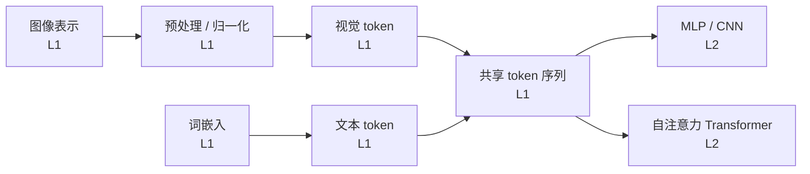

# AIE1903 知识体系

## 一、课程知识总览

本课程围绕「多模态智能助手如何把原始输入变成可计算的 token，并交给神经网络处理」展开，分两条主线：

1. **输入表示（L1）**：把图像与文本两种原始信号统一成可计算的表示——图像经解码、预处理、归一化变成 H×W×3 张量，文本经分词、查嵌入表变成稠密向量；再通过「图像分块 + 线性投影」得到视觉 token，与文本 token 拼接成共享序列，完成「从原始像素与词到多模态 token」的第一步。
2. **网络架构（L2）**：在 token 之上，讲透三种基础神经网络——MLP（全连接、逐点变换）、CNN（共享卷积核、保留局部结构）、Transformer（自注意力全局交互 + LayerNorm + 残差连接），并比较三者的适用场景与组合方式。

两条主线由「token 序列」连接：L1 负责**产出** token 序列，L2 负责**处理** token 序列。

## 二、各课件知识点概览

- [L1 Input Processing (1)](<L1 Input Processing (1)/L1 Input Processing (1)-知识点摘要.md>) — 图像表示、预处理与归一化、词嵌入、视觉 token 与多模态输入
- [L2-MLP CNN Transformer(1)](<L2-MLP CNN Transformer(1)/L2-MLP CNN Transformer(1)-知识点摘要.md>) — MLP、CNN、自注意力与 Transformer、三种架构对比

## 三、跨课件知识点联系

- **归一化（L1）→ 神经网络（L2）**：像素重缩放与均值–标准差归一化给网络提供尺度稳定、通道可比的输入，是「许多模型错误其实来自输入准备错误」的前置环节。
- **词嵌入 + 注意力（L1）→ 自注意力/Transformer（L2）**：嵌入把 token 变成稠密向量，注意力让 token 之间信息流动——这正是 L2 自注意力机制 QKV 的来源。
- **视觉 token 的分块投影（L1）→ 线性投影层（L2）**：L1 的「图像分块 + 线性投影」正是 L2 线性层在输入端的落地，二者共用同一套「矩阵变换特征维度」的语言。

