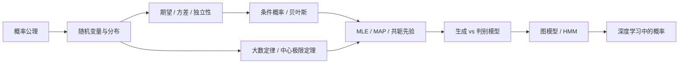

# AIE2040 知识体系

## 一、课程知识总览

本课程为 AI 建模提供「概率与统计」的语言和工具，逻辑链条清晰：**先定义概率 → 再用随机变量与分布描述世界 → 用期望/方差/独立性做基本推理 → 用条件概率与贝叶斯做证据更新 → 用极限定理理解长期行为 → 用熵度量不确定性 → 最后把概率落地到估计、图模型与深度学习**。

三条主线贯穿始终：

1. **描述**：概率公理 → 随机变量（离散/连续）→ 各分布族 → 指数族的统一视角。
2. **推理**：条件概率 → 贝叶斯定理 → 独立性 → 大数定律/中心极限定理 → 信息熵。
3. **应用**：点估计（MLE/矩估计）→ 贝叶斯估计（MAP/完整贝叶斯/共轭先验）→ 生成/判别模型 → 概率图模型与 HMM → 深度学习中的概率 → 真实案例与常见误区。

## 二、各课件知识点概览

- [probability-statistics-ai-lecture [Repaired]](<probability-statistics-ai-lecture [Repaired]/probability-statistics-ai-lecture [Repaired]-知识点摘要.md>) — 概率公理、随机变量与分布、贝叶斯、极限定理、熵、MLE/MAP/共轭先验、图模型与 HMM、深度学习概率、应用案例与误区

## 三、知识点联系（主线）

- **公理 → 分布**：三条公理是概率的地基，随机变量与 PMF/PDF/CDF 是描述世界的语言，期望/方差/独立性是基本推理工具。
- **条件概率 → 贝叶斯 → 估计**：贝叶斯定理「后验 ∝ 先验 × 似然」既用于诊断推理，也是 MAP/完整贝叶斯估计的直接来源；MLE 则是「只看似然」的特例。
- **分布 → 指数族 → 共轭**：指数族的统一形式带来充分统计量与共轭先验，使贝叶斯更新有解析解。
- **概率 → 模型 → 深度学习**：生成/判别模型是估计的产物，图模型/HMM 是结构化概率，softmax/交叉熵/VAE 的 ELBO 把概率思想搬到深度学习。
- **极限定理 → 估计质量**：大数定律与中心极限定理保证估计随样本增多而稳定，费雪信息与渐近正态性给 MLE 配上标准误与置信区间。

