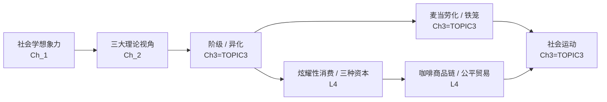

# GEC3407 知识体系

## 一、课程知识总览

本课程从社会学视角审视**消费、食物与劳动**，宏观脉络是「先给出一套看社会的工具 → 再用这套工具剖析全球经济中的劳动 → 最后落到消费、阶级与文化资本的微观分析」，分三层：

1. **视角与概念（Ch_1quiz、Ch_2 quiz）**：社会学想象力、社会结构、三大理论视角（功能主义/冲突论/互动论）、文化、越轨与社会控制等基础概念，以及马克思、涂尔干、韦伯、马蒂诺等奠基人的视角。
2. **全球经济中的劳动（Chapter 3、TOPIC 3 quiz）**：阶级与雇佣劳动、异化、跨国公司、商品链、全球北方/南方、意识形态与霸权、韦伯「铁笼」与麦当劳化、社会运动与民族志研究。
3. **消费、阶级与文化资本（L4 QUIZ）**：阶级/地位/社会流动、炫耀性消费、支出级联、布尔迪厄三种资本、公共空间与第三空间、咖啡商品链与公平贸易、调查研究方法。

## 二、各课件知识点概览

- [Ch_1quiz version](<Ch_1quiz version/Ch_1quiz version-知识点摘要.md>) — 社会学想象力、社会结构、消费文化、资本主义、全球化、社会学奠基人、思维框架
- [Ch_2(QUIZ VERSION)](<Ch_2(QUIZ VERSION)/Ch_2(QUIZ VERSION)-知识点摘要.md>) — 食物社会学、三大理论视角、文化、越轨与社会控制、价值观、文化相对主义、研究取向
- [Chapter 3](<Chapter 3/Chapter 3-知识点摘要.md>) — 阶级与雇佣劳动、异化、全球经济、意识形态/霸权、麦当劳化、社会运动、民族志
- [TOPIC 3(quiz VERSION)](<TOPIC 3(quiz VERSION)/TOPIC 3(quiz VERSION)-知识点摘要.md>) — 阶级与雇佣劳动、异化、跨国公司、商品链、意识形态/霸权、麦当劳化、社会运动、民族志
- [L4 QUIZ VERSION](<L4 QUIZ VERSION/L4 QUIZ VERSION-知识点摘要.md>) — 阶级/地位/社会流动、炫耀性消费、支出级联、三种资本、第三空间、咖啡商品链/公平贸易、调查研究

## 三、跨课件知识点联系

- **三大理论视角（Ch_2）→ 各课件分析**：功能主义、冲突论、互动论这副「眼镜」被反复用于后续分析——马克思的异化与商品拜物教（Chapter 3/TOPIC 3）是冲突论，涂尔干的食物图腾与神圣/世俗（Ch_2）是功能主义。
- **阶级与雇佣劳动（Chapter 3 = TOPIC 3 quiz）→ 消费分析（L4）**：阶级是贯穿本课程的核心概念；L4 从阶级延伸到地位、社会流动与炫耀性消费，把「阶级位置」落到「消费信号」。
- **异化（Chapter 3/TOPIC 3）→ 麦当劳化（Chapter 3/TOPIC 3）**：异化的四重疏离被麦当劳化「理性的非理性」放大，成为对当代劳动最集中的批判。
- **社会运动（Chapter 3/TOPIC 3）→ 伦理消费与公平贸易（L4）**：面对全球经济的弊端，社会运动是宏观出路，伦理消费/公平贸易（L4）是微观的「美元投票」路径。
- **研究方法**：定性（Ch_2 的定性访谈、Chapter 3/TOPIC 3 的民族志）与定量（L4 的调查研究）互为补充，分别揭示意义的深层与总体分布的广度。

